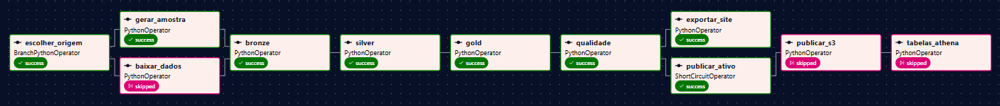

# cnpj-pipeline

Pipeline ETL em lote sobre os dados abertos do CNPJ da Receita Federal do Brasil. O objetivo do projeto é tratar um dataset público grande (alvo de 5 a 10 GB de dado bruto) com problemas reais de qualidade: arquivos sem cabeçalho, separador `;`, encoding `ISO-8859-1`, vírgula decimal, datas em texto e valores sentinela.

Status: versão pública no ar, com o site em https://igorlmor3.github.io/cnpj-pipeline/. O pipeline (raw, bronze, silver e gold) foi executado sobre quatro meses reais (2026-07 a 2026-10), com todas as verificações de qualidade passando em cada um, e a gold foi publicada na AWS (S3, Glue e Athena) e consultada com SQL. O agente de texto para SQL foi avaliado com o modelo real (conjunto reservado `validacao`: 24 de 25 na primeira execução; `holdout` em cinco repetições: 119 de 120) e sua API pública está publicada na AWS, com limite de perguntas por visitante, teto de gasto e chave de desligamento. O site em React (pasta [site/](site/README.md)) está publicado no GitHub Pages, com as respostas gravadas do agente e a caixa de perguntas ao vivo. Seguem no [Roadmap](#roadmap) a execução do pipeline na nuvem (nível 2) e o teste de desempenho em amostra grande.

## Fonte dos dados

- Catálogo: https://dados.gov.br/dados/conjuntos-dados/cadastro-nacional-da-pessoa-juridica---cnpj
- Repositório de arquivos da Receita Federal: https://arquivos.receitafederal.gov.br/ (Dados > Cadastros > CNPJ)

Os arquivos são publicados mensalmente como `.zip` com CSVs. As tabelas são Empresas, Estabelecimentos e Sócios (divididas em várias partes) e as tabelas de domínio Cnaes, Motivos, Municípios, Naturezas, Países, Qualificações e Simples.

A Receita alterou o layout da página e o caminho dos arquivos no início de 2026. Os arquivos ficam em um compartilhamento público Nextcloud acessado por WebDAV, e o template de URL padrão do script segue esse formato (documentado pelo pacote comunitário `rfbpy`). Esse padrão é o usado nos downloads do mês 2026-10. O template é configurável (`CNPJ_URL_TEMPLATE` ou `--url-template`). O dicionário de layout publicado junto com os arquivos de cada mês é a referência para os esquemas das tabelas.

## Arquitetura planejada

```
Receita Federal (zip/CSV)
        |
        v
data/raw      arquivos originais, imutáveis, com manifesto (tamanho e SHA-256)
        |
        v
data/bronze   CSV convertido para Parquet, sem regras de negócio, tudo como texto
        |
        v
data/silver   tipos corrigidos, datas e decimais tratados, sentinelas viram nulo,
              registros rejeitados vão para uma tabela de quarentena
        |
        v
data/gold     dimensões, fato por estabelecimento e marts agregados (por exemplo,
              estabelecimentos ativos por município e CNAE)
```

O motor de transformação é o DuckDB. As decisões tomadas e as ainda em aberto estão registradas em [docs/architecture.md](docs/architecture.md).

## Visão geral do projeto

O projeto tem cinco frentes. O pipeline, a publicação na AWS (nível 1), a análise e o agente com a sua API pública e o site publicado já existem; o nível 2 da AWS segue o [Roadmap](#roadmap).

1. **Pipeline de dados (implementado até a gold).** Download com retomada, bronze, profiling, silver e gold, todos testados com dados sintéticos e executados no CI. O fluxo completo já rodou sobre o mês real 2026-10.
2. **Publicação na AWS (nível 1 aplicado e validado com a gold do mês real; nível 2 planejado).** Será feita em dois níveis, nesta ordem:
   - Nível 1: o pipeline continua rodando localmente e publica o Parquet (bronze, silver e gold) em um bucket S3, com o mesmo particionamento por `reference_month`. Um catálogo no AWS Glue e consultas no Athena permitem rodar SQL sobre os dados na nuvem. A infraestrutura é descrita em Terraform (`infra/`), com um usuário IAM restrito ao bucket e alerta de orçamento. O código tem testes com clientes simulados e o ambiente já foi aplicado em uma conta real, com a gold do mês 2026-10 publicada e consultada no Athena. Veja [Publicação na AWS (nível 1)](#publicação-na-aws-nível-1).
   - Nível 2: o pipeline passa a rodar na nuvem, em um container no ECS Fargate (a imagem Docker já existe), lendo e gravando `s3://` diretamente. O acesso passa a ser feito por papel IAM da tarefa, sem chaves.
3. **Análise e insights (primeira versão pronta).** Um relatório com os principais achados sobre o cadastro de empresas, gerado a partir da camada gold, em [docs/analysis/2026-10.md](docs/analysis/2026-10.md): perfil por porte e natureza jurídica, Simples e MEI por UF, crescimento de aberturas por setor e a distorção que as eleições municipais causam na série de aberturas. A evolução entre quatro meses (2026-07 a 2026-10) tem relatório próprio em [docs/analysis/evolucao_2026-07_a_2026-10.md](docs/analysis/evolucao_2026-07_a_2026-10.md). O site público com gráficos está em [site/](site/README.md).
4. **Agente de IA para perguntas sobre os dados (implementado, com API pública).** Um agente de texto para SQL: o modelo recebe o esquema da gold, escreve uma consulta, ela roda em modo somente leitura e o resultado é explicado em linguagem natural. Embeddings ficam restritos a partes pequenas, como busca por descrição de CNAE ou natureza jurídica. O agente só enxerga tabelas permitidas e toda consulta passa por validação antes de executar. A API pública é uma função na AWS Lambda com limite de perguntas por visitante e por dia, teto de gasto e uma chave de desligamento; os passos de publicação estão em [infra/README.md](infra/README.md).
5. **Site em React com Tailwind (publicado no GitHub Pages).** Uma página pública no estilo de catálogo, com a análise, gráficos a partir de agregados pré-calculados e o agente de perguntas. Hospedagem estática, fora da AWS, para não depender do prazo do plano gratuito. Veja [site/README.md](site/README.md).

Princípios que valem para todas as frentes:

- **Privacidade.** O cadastro de sócios contém nomes de pessoas físicas. Qualquer saída pública (análise, site e agente) usa apenas agregados e não permite consulta por pessoa.
- **Custo baixo e controlado.** Nuvem com alerta de orçamento desde o primeiro dia, região de menor custo, sem NAT Gateway, limite de leitura de dados por consulta no Athena e `terraform destroy` para desmontar o ambiente. O agente público tem limite de perguntas por visitante, teto mensal de gasto no provedor do modelo e perguntas de exemplo que funcionam sem chamar o modelo.
- **Honestidade sobre o estado.** Este README distingue o que está implementado do que é planejado, e os números só entram na seção de resultados depois de medidos.

As escolhas feitas para cada decisão, com as alternativas consideradas, estão em [docs/architecture.md](docs/architecture.md).

## Estrutura do repositório

```
.
├── data/                  dados locais (não versionados)
│   ├── raw/
│   ├── bronze/
│   ├── silver/            Parquet tipado, mais _quarantine/ com as linhas rejeitadas
│   └── gold/              dimensões, fato e marts em Parquet, mais o manifesto do mês
├── docs/
│   ├── architecture.md    decisões de arquitetura
│   ├── data_quality_rules.md   catálogo de problemas de qualidade e decisões
│   ├── agent_design.md    desenho do agente de texto para SQL e suas defesas
│   ├── agent_eval/        relatórios de avaliação do agente (contagens, métricas e SQL)
│   ├── site_data.md       arquivos JSON do site e o que torna a saída segura para publicar
│   ├── profiling/         relatórios gerados pelo profiling (apenas agregados)
│   ├── silver/            relatório das regras aplicadas na silver (apenas contagens)
│   ├── gold/              relatório dos modelos e das verificações da gold (apenas contagens)
│   ├── quality/           relatório de qualidade entre camadas e tempos medidos (apenas contagens)
│   └── analysis/          análise do cadastro a partir da gold (apenas agregados)
├── src/cnpj_pipeline/
│   ├── config.py          caminhos e configuração
│   ├── download.py        download parametrizado com retomada e manifesto
│   ├── schemas.py         colunas de cada tabela (layout a validar contra o dicionário do mês)
│   ├── bronze.py          zip/CSV para Parquet com DuckDB
│   ├── profiling.py       relatórios de qualidade de dados sobre a bronze
│   ├── silver_rules.py    regras de limpeza e tipagem por coluna (provisórias)
│   ├── silver.py          bronze para silver: tipos, limpeza, quarentena e deduplicação
│   ├── gold_models.py    modelos da gold em SQL: dimensões, fato e marts
│   ├── gold.py            silver para gold: construção, verificações de qualidade e manifesto
│   ├── quality.py         verificações de qualidade sobre a silver e entre camadas, e tempos medidos
│   ├── cloud/             publicação no S3 (publish.py) e tabelas/consultas no Athena (athena.py)
│   ├── agent/             agente de texto para SQL: guarda, contexto, executores, cliente do modelo, laço, gasto, avaliação e gravador de respostas de exemplo
│   ├── api/               função da API pública do agente: limites, orçamento, interruptor e empacotamento
│   ├── site_export.py     exportação de agregados da gold para JSON (dados do site)
│   ├── sample.py          gerador de zips sintéticos com defeitos plantados
│   ├── orchestration.py   comandos de cada etapa por modo (amostra ou mês real), usados pela DAG e para rodar vários meses
│   ├── evolution.py       compara fotos mensais consecutivas: novos, removidos e mudanças de situação (mart_movimentos)
│   ├── site_evolution.py  exporta a série entre meses para o site (evolucao.json)
│   └── demo.py            amostra, bronze, profiling, silver e gold de ponta a ponta
├── orchestration/         Airflow em Docker Compose e a DAG cnpj_monthly
├── infra/                 Terraform da AWS (bucket, Glue, Athena, IAM, orçamento e, opcional, a API do agente)
├── site/                  site em React e Tailwind (Vite): lê os JSON agregados e chama a API do agente
├── tests/
├── .github/workflows/      ci.yml (testes do Python e do site) e pages.yml (publicação do site)
├── Dockerfile
├── docker-compose.yml
└── pyproject.toml
```

## Demonstração rápida (sem baixar nada)

Para ver o pipeline inteiro funcionando em poucos segundos, sem os 8 GB reais:

```bash
python -m cnpj_pipeline.demo
```

O comando gera zips sintéticos no formato dos arquivos da Receita, com defeitos plantados de propósito (espaços nas bordas, `;` e aspas dentro de textos, decimais com ponto, datas zeradas e inválidas, chaves duplicadas, órfãs e inválidas, linhas com número de colunas errado), converte tudo para Parquet na bronze, roda o profiling e constrói as camadas silver e gold. A saída fica em `data/sample/`, separada dos dados reais. Os relatórios em `data/sample/profiling/2000-01/` mostram os defeitos sendo encontrados, `data/sample/silver_report/` mostra o que a silver corrigiu e `data/sample/gold_report/` mostra os modelos da gold e as verificações. Todos os dados são inventados e não correspondem a pessoas ou empresas reais.

O mesmo fluxo roda como teste automatizado no CI a cada push.

## Como executar

### Com Docker

```bash
cp .env.example .env
docker compose build
docker compose run --rm pipeline python -m cnpj_pipeline.download --month 2026-11 --dry-run
docker compose run --rm pipeline python -m cnpj_pipeline.download --month 2026-11
docker compose run --rm pipeline pytest
```

### Sem Docker

Requer Python 3.11 ou superior.

```bash
python -m venv .venv
source .venv/bin/activate        # no Windows: .venv\Scripts\activate
pip install -e ".[dev]"
python -m cnpj_pipeline.download --month 2026-11 --dry-run
```

## Download

`python -m cnpj_pipeline.download` baixa os arquivos de um mês de referência para `data/raw/<AAAA-MM>/`.

| Opção | Descrição |
| --- | --- |
| `--month AAAA-MM` | Mês de referência (obrigatório) |
| `--tables T [T ...]` | Subconjunto de tabelas, sem diferenciar maiúsculas (padrão: todas) |
| `--parts N` | Número de partes das tabelas divididas (padrão: 10) |
| `--out-dir PASTA` | Pasta de destino (padrão: `data/raw`) |
| `--url-template URL` | Template com `{month}` e `{filename}` (padrão: compartilhamento WebDAV oficial) |
| `--share-token TOKEN` | Token do compartilhamento WebDAV (padrão: `CNPJ_SHARE_TOKEN`; só é enviado ao servidor oficial) |
| `--workers N` | Downloads em paralelo; o servidor oficial limita arquivos grandes (padrão: 2) |
| `--retries N` | Tentativas por arquivo (padrão: 8) |
| `--no-checksum` | Não calcula o SHA-256 |
| `--dry-run` | Lista as URLs sem baixar |
| `--manifest-only` | Não acessa a rede: gera o manifesto a partir dos arquivos já presentes na pasta do mês |

O servidor oficial fica atrás de um balanceador que às vezes responde vazio ou derruba a conexão, e baixar pelo navegador costuma travar sem retomar. O script lida com isso: retoma downloads interrompidos (arquivo `.part` e cabeçalho HTTP `Range`), repete tentativas com backoff exponencial (inclusive para respostas vazias e limites de taxa 408/429), confere o tamanho final contra o `Content-Length` e grava `manifest.json` com tamanho e SHA-256 de cada arquivo. Partes que retornam 404 em tabelas divididas são ignoradas com aviso. Se nenhuma parte de uma tabela for obtida, o script termina com código de saída diferente de zero.

Para testar a conexão antes do download grande, baixe só as tabelas pequenas: `python -m cnpj_pipeline.download --month 2026-10 --tables cnaes motivos`. Se o servidor oficial estiver indisponível, `--url-template` aceita um espelho de terceiros com os mesmos zips (por exemplo, o espelho da Casa dos Dados, `https://dados-abertos-rf-cnpj.casadosdados.com.br/arquivos/<data-da-pasta>/{filename}`). O manifesto guarda a URL e o SHA-256 de cada arquivo baixado, mas não prova que o espelho é idêntico ao original.

Se os arquivos já foram baixados manualmente, coloque-os em `data/raw/<AAAA-MM>/` e rode `python -m cnpj_pipeline.download --month AAAA-MM --manifest-only` para gerar o manifesto sem acessar a rede. Rodar o download normal com o mesmo mês também funciona: arquivos completos são reconhecidos, pulados e incluídos no manifesto.

## Camada bronze

`python -m cnpj_pipeline.bronze --month AAAA-MM` lê os zips de `data/raw/<AAAA-MM>/` e grava Parquet em `data/bronze/<tabela>/reference_month=<AAAA-MM>/`.

| Opção | Descrição |
| --- | --- |
| `--month AAAA-MM` | Mês de referência (obrigatório) |
| `--tables T [T ...]` | Subconjunto de tabelas (padrão: todas as que tiverem zip na pasta) |
| `--force` | Refaz arquivos que já existem na bronze (por padrão são pulados) |
| `--memory-limit` | Limite de memória do DuckDB; o excedente vai para disco (padrão: 4GB) |
| `--threads N` | Threads do DuckDB (padrão: automático) |
| `--max-reject-ratio` | Fração máxima de linhas rejeitadas por arquivo antes de falhar (padrão: 0,001) |

Comportamento:

- Todas as colunas são gravadas como texto. Tipagem e regras de negócio ficam para a camada silver.
- O encoding latin-1 é convertido para UTF-8 na extração do zip, byte a byte e sem perder nenhum caractere, e campos vazios viram NULL. A conversão é feita no pipeline porque os dados reais de 2026-10 trazem bytes de controle C1 (`0x80` a `0x9F`) que o decodificador latin-1 do DuckDB recusa. Esses bytes são contados no log e no manifesto (`control_chars`), mantidos na bronze e removidos pela regra de texto da silver.
- Cada CSV é extraído do zip em streaming para uma pasta temporária (`data/tmp`, apagada ao final), porque o DuckDB não lê CSV de dentro de zip.
- Linhas com número de colunas errado ou aspas inválidas não são descartadas em silêncio: vão para `data/bronze/_rejects/` com o número da linha, o texto original e o motivo. Se a fração de rejeitadas passar do limite, o arquivo falha e o Parquet é removido.
- Antes de converter, a quantidade de colunas mais frequente entre os primeiros 1000 registros é comparada com `schemas.py`. Algumas linhas quebradas no início não reprovam o arquivo, mas uma mudança real de layout para o processamento com uma mensagem clara.
- O dialeto do CSV (separador, aspas, colunas, encoding) é informado explicitamente ao DuckDB, sem detecção automática. Isso é mais rápido, determinístico e aceita arquivos com fim de linha LF ou CRLF.
- Cada Parquet inclui `_source_file`, `_reference_month` e `_ingested_at`. O diretório `reference_month=...` segue a convenção Hive, então o DuckDB também expõe `reference_month` ao ler a pasta inteira.
- Um manifesto `data/bronze/_manifest_<mes>.json` registra linhas, rejeitadas, tamanhos e tempo de cada arquivo. Esses números alimentam a tabela de resultados abaixo.

Os nomes das colunas em `schemas.py` seguem o layout histórico e foram validados contra os dados de 2026-10 (10 tabelas, sem linhas rejeitadas).

## Profiling

`python -m cnpj_pipeline.profiling --month AAAA-MM` lê a camada bronze e gera, para cada tabela, `docs/profiling/<mês>/<tabela>.md` e `.json`, mais `referential.md` e `.json`.

Por coluna, o relatório mede nulos, valores distintos (aproximado), tamanho do texto, espaços nas bordas, caracteres de controle e de substituição (problema de encoding), padrões de formato (dígitos viram `9`, letras viram `A`), valores candidatos a sentinela, validade de datas `AAAAMMDD` e formato de decimais com vírgula. Por tabela, mede duplicidade da chave de negócio presumida e, entre tabelas, chaves órfãs nas relações presumidas (por exemplo, estabelecimentos sem empresa correspondente).

| Opção | Descrição |
| --- | --- |
| `--tables T [T ...]` | Subconjunto de tabelas (padrão: todas com Parquet na bronze) |
| `--sample-percent N` | Perfila só N% das linhas, para tabelas grandes (resultados aproximados) |
| `--skip-referential` | Pula a checagem de integridade referencial, que é a etapa mais pesada |
| `--memory-limit` | Limite de memória do DuckDB (padrão: 4GB) |
| `--out-dir` | Pasta dos relatórios (padrão: `docs/profiling`) |

Os relatórios contêm apenas agregados. Valores literais aparecem somente para colunas categóricas de baixa sensibilidade (códigos e indicadores). Nomes, documentos, endereços e contatos aparecem só como padrões mascarados e contagens, então os relatórios podem ser versionados.

Os achados são candidatos, não veredictos. Um valor como `00000000` em `cnpj_basico`, por exemplo, pode ser legítimo, e cada caso precisa de decisão humana antes de virar regra em `docs/data_quality_rules.md`.

Se uma tabela foi processada só em parte (nem todas as partes), as chaves órfãs refletem a ausência de arquivos e não um problema nos dados.

## Camada silver

`python -m cnpj_pipeline.silver --month AAAA-MM` lê a bronze (tudo texto) e grava `data/silver/<tabela>/reference_month=<mês>/<tabela>.parquet` com tipos corretos.

O que a silver faz, tabela por tabela:

- Datas `AAAAMMDD` viram `DATE`; zeros e datas inexistentes (como 31 de fevereiro) viram NULL.
- Decimais com vírgula viram `DECIMAL(20,2)`; valores inválidos viram NULL.
- Indicadores `S`/`N` viram `BOOLEAN`; a lista de CNAEs secundários vira `VARCHAR[]`.
- Textos são limpos (caracteres de controle, espaços repetidos e nas bordas); vazio vira NULL. Códigos mantêm os zeros à esquerda.
- Valores que significam "não informado" viram NULL: nos campos de endereço e no nome fantasia, textos só de zeros, pontos ou hífens, `N/A`, `NULL`, `NAO INFORMADO` e `SEM INFORMACAO`; em telefone, DDD, fax e CEP, valores só de zeros. Essas regras vieram do profiling do mês real (2026-10). `S/N` no número é mantido, porque é o valor padrão de "sem número".
- UF fora das 27 siglas (mais `EX`) vira NULL; e-mail vai para minúsculas.
- Chaves obrigatórias inválidas (por exemplo `cnpj_basico` fora de 8 posições alfanuméricas) enviam a linha para `data/silver/_quarantine/` com o motivo em `_reject_reason`.
- Chaves de negócio duplicadas mantêm uma linha, escolhida de forma determinística (a mais preenchida depois da limpeza; no empate, o hash do conteúdo, então a ordem de entrada não importa), e as demais vão para a quarentena como `duplicate_key`.
- Estabelecimentos ganha a coluna derivada `cnpj` (14 posições).

Se a fração de linhas em quarentena de uma tabela passar de `--max-quarantine-ratio` (padrão 1%), a tabela falha e a saída silver é removida; a quarentena fica para inspeção. O manifesto `data/silver/_manifest_<mês>.json` e o relatório `docs/silver/<mês>.md` registram, por coluna, quantos valores foram anulados ou alterados (apenas contagens, sem valores).

| Opção | Descrição |
| --- | --- |
| `--tables T [T ...]` | Subconjunto de tabelas (padrão: todas com Parquet na bronze) |
| `--force` | Refaz tabelas que já existem na silver |
| `--max-quarantine-ratio` | Fração máxima em quarentena por tabela (padrão: 0.01) |
| `--memory-limit` | Limite de memória do DuckDB (padrão: 4GB) |
| `--report-dir` | Pasta do relatório (padrão: `docs/silver`) |

As regras estão em `silver_rules.py`. Parte delas já foi ajustada com o profiling do mês real (2026-10), como o tratamento de bytes de controle e de valores de espaço reservado, mas o catálogo em [docs/data_quality_rules.md](docs/data_quality_rules.md) ainda precisa ser fechado regra a regra.

## Camada gold

`python -m cnpj_pipeline.gold --month AAAA-MM` lê a silver e grava `data/gold/<modelo>/reference_month=<mês>/<modelo>.parquet`. Os modelos são consultas SQL do DuckDB em `gold_models.py`.

| Modelo | Conteúdo |
| --- | --- |
| `dim_cnae`, `dim_cnae_secao` | Subclasses da CNAE com divisão e seção; as 21 seções (A a U) do IBGE |
| `dim_natureza_juridica` | Natureza jurídica com o grupo (primeiro dígito do código) |
| `dim_municipio`, `dim_qualificacao_socio` | Municípios e qualificações de sócio, vindos das tabelas de domínio |
| `dim_situacao_cadastral`, `dim_porte` | Rótulos dos códigos documentados no layout da Receita |
| `fato_estabelecimento` | Uma linha por CNPJ de 14 posições: situação, datas, CNAE principal e seção, UF, município, natureza, porte, capital social e indicadores de Simples e MEI, mais a marcação `is_organizacao_politica` (CNAE 9492800) |
| `mart_aberturas_mensal` | Estabelecimentos abertos por mês, UF e seção da CNAE, separados pela marcação de organização política |
| `mart_estabelecimentos_ativos` | Estabelecimentos ativos por UF, município e divisão da CNAE |
| `mart_perfil_porte_natureza` | Empresas ativas, capital social total e mediano por porte e natureza jurídica |
| `mart_simples_mei_uf` | Empresas ativas e participação de Simples e MEI por UF |
| `mart_socios_qualificacao` | Sócios por qualificação e tipo (pessoa física, jurídica ou estrangeiro) |

Decisões de modelagem:

- O fato não tem razão social, nome fantasia, endereço, telefone, e-mail nem nomes de sócios. A gold é a base das saídas públicas (site e agente), que usam apenas agregados, e um teste confere que nenhuma dessas colunas nem valores de exemplo aparecem nos arquivos.
- "Empresa ativa" nos marts é a matriz com situação cadastral ativa, o que conta cada empresa uma só vez, mesmo com várias filiais.
- Empresa sem linha em Simples é tratada como não optante pelo Simples nem pelo MEI.
- Os marts de aberturas mostram o que existe no cadastro do mês: estabelecimentos já removidos do cadastro não aparecem, então a série histórica pode subestimar aberturas antigas.
- Os rótulos de códigos (situação, porte, tipo de sócio) e as seções da CNAE são tabelas fixas em `gold_models.py`, e não vêm dos arquivos da Receita.
- O CNAE 9492800 (atividades de organizações políticas) cria picos nos anos de eleição municipal (a explicação provável são CNPJs de campanha, que o cadastro sozinho não demonstra) (ver [análise](docs/analysis/2026-10.md)). O fato traz a coluna `is_organizacao_politica`, e `mart_aberturas_mensal`, `mart_estabelecimentos_ativos`, `mart_perfil_porte_natureza` e `mart_simples_mei_uf` agrupam por ela, então cada consulta escolhe ler com ou sem esses registros. Somar sem filtrar continua dando o cadastro inteiro.

Depois de construir, a gold roda verificações. As bloqueantes fazem o comando falhar (código de saída 1) e indicam que a gold não deve ser publicada: o CNPJ de 14 posições não se repete no fato, o fato tem as mesmas linhas que Estabelecimentos na silver, a soma de cada mart bate com a contagem correspondente no fato (e a de sócios, com a silver), a marcação de organização política no fato bate com a contagem do CNAE 9492800 na silver, a soma das aberturas marcadas bate com o fato e as dimensões não repetem código. A informativa registra, sem falhar, quantos estabelecimentos têm UF ou data de início nulas, natureza nula ou sem empresa correspondente e chaves sem correspondência nas dimensões de CNAE, município e natureza. O manifesto `data/gold/_manifest_<mês>.json` e o relatório `docs/gold/<mês>.md` trazem apenas contagens.

| Opção | Descrição |
| --- | --- |
| `--models M [M ...]` | Subconjunto de modelos (padrão: todos); os modelos que dependem deles entram junto, para não sobrar mart antigo ao lado de fato novo |
| `--force` | Refaz modelos que já existem; modelos que dependem de um modelo refeito são refeitos junto |
| `--memory-limit` | Limite de memória do DuckDB (padrão: 4GB) |
| `--report-dir` | Pasta do relatório (padrão: `docs/gold`) |

Um modelo cuja silver ou cujo modelo de origem não existe é pulado com aviso. Os números da primeira execução sobre o mês real estão em [Resultados medidos](#resultados-medidos).

## Publicação na AWS (nível 1)

O nível 1 mantém o processamento local e leva o resultado para a nuvem. O passo a passo completo, com pré-requisitos, custos e como desmontar tudo, está em [infra/README.md](infra/README.md).

- `infra/` (Terraform): bucket S3 privado e criptografado, banco no Glue, workgroup do Athena com limite de dados lidos por consulta, usuário IAM de menor privilégio e alerta de orçamento. As chaves de acesso não passam pelo Terraform. Um módulo opcional (`infra/modules/api/`) cria a API pública do agente, com a chave do provedor guardada no Parameter Store fora do Terraform.
- `python -m cnpj_pipeline.cloud.publish --month AAAA-MM`: envia o Parquet ao S3 de forma idempotente (pula arquivos idênticos por tamanho e SHA-256) e confere o tamanho de cada envio. Por padrão envia só a silver (com `--layers gold` envia a gold, que não tem nomes de pessoas); quarentena e rejeitados, que contêm linhas originais, só com `--include-quarantine`. Aceita `--dry-run`.
- `python -m cnpj_pipeline.cloud.athena create-tables`: cria as tabelas externas da silver (`silver_<tabela>`) ou, com `--layer gold --month AAAA-MM`, da gold (`gold_<modelo>`, com as colunas lidas do manifesto da gold), com partition projection em `reference_month` (sem crawler e sem `MSCK REPAIR`). Testes conferem que as colunas do DDL batem com o Parquet que cada camada realmente grava. O subcomando `query` executa consultas.

O suporte à AWS é opcional: `python -m pip install -e ".[aws]"`. Os testes usam clientes simulados e não exigem conta nem rede.

## Orquestração (Airflow)

O fluxo completo roda como uma DAG do Apache Airflow 3, a `cnpj_monthly`: dados brutos (ou amostra sintética), bronze, silver, gold, qualidade, exportação para o site e, de forma opcional, publicação no S3 e tabelas no Athena. A tarefa de qualidade é um portão: se uma verificação bloqueante falhar, nada é exportado nem publicado. A DAG tem parâmetros (`mode`: `sample` ou `full`, `month`, `force`, `publish`), roda sem agenda e uma execução por vez. O modo `sample` percorre o fluxo inteiro em segundos, sem baixar nada e sem tocar nos dados reais.

```bash
cd orchestration
docker compose up airflow-init
docker compose up -d        # http://localhost:8080
```



A lógica de montagem dos comandos fica em `src/cnpj_pipeline/orchestration.py` e é testada sem Airflow; a integridade da DAG é testada com o Airflow 3.4.0 instalado. Decisões, parâmetros e limites estão em [orchestration/README.md](orchestration/README.md).

## Evolução entre meses

Cada mês da Receita é uma foto completa do cadastro. `cnpj_pipeline.orchestration` roda o fluxo para vários meses em sequência (`--months 2026-07 2026-08 2026-09`), e `cnpj_pipeline.evolution` compara fotos consecutivas CNPJ a CNPJ e grava na gold um mart agregado, `mart_movimentos`, com os CNPJs novos, os que sumiram e as mudanças de situação cadastral, por UF e seção da CNAE. Nos CNPJs novos, o mart registra a defasagem entre o início da atividade e o mês da foto, que separa abertura de registro tardio.

```bash
python -m cnpj_pipeline.orchestration --months 2026-07 2026-08 2026-09
python -m cnpj_pipeline.evolution --months 2026-07 2026-08 2026-09 2026-10
python -m cnpj_pipeline.site_evolution --months 2026-07 2026-08 2026-09 2026-10
```

Duas verificações bloqueantes conferem a aritmética entre as fotos (o total de estabelecimentos e o de ativos da foto atual têm de bater com a anterior mais os movimentos), e a exportação para o site recusa a série se o saldo de ativos dos movimentos não fechar com a diferença entre os estoques. O mart e o JSON só têm contagens: nenhum CNPJ sai da gold. O relatório de cada mês fica em `docs/evolution/`.

## Qualidade de dados

Cada problema encontrado nos dados é registrado em [docs/data_quality_rules.md](docs/data_quality_rules.md) com a decisão tomada (corrigir, anular ou rejeitar), a camada em que a regra é aplicada e o teste que a cobre. O catálogo é preenchido durante o profiling e não parte de suposições.

Além das regras aplicadas em cada camada, o módulo `quality.py` confere o resultado depois que as camadas estão prontas:

```
python -m cnpj_pipeline.quality --month 2026-10            # completa
python -m cnpj_pipeline.quality --month 2026-10 --quick    # pula as verificações pesadas
```

- Por linha: formato do CNPJ (12 posições de base e ordem, que aceitam letras do CNPJ alfanumérico, mais 2 dígitos), dígitos verificadores pelo módulo 11 (também para o formato alfanumérico), domínios de códigos (matriz/filial, situação cadastral, porte, tipo de sócio), datas futuras, anteriores a 1900 ou incoerentes entre si, e capital social negativo.
- Sobre o conjunto: unicidade de chaves, empresas sem estabelecimento matriz e sócios sem empresa.
- Entre camadas: linhas da bronze iguais às de entrada da silver; saída mais quarentena iguais à entrada; Parquet e quarentena iguais ao que o manifesto registra; e as verificações bloqueantes da gold.

Cada verificação é bloqueante (o comando termina com código 1) ou informativa (só registra a contagem e a proporção). O relatório `docs/quality/<mês>.md` traz apenas contagens, os tempos de cada camada lidos dos manifestos e a especificação da máquina. `--quick` pula as verificações que exigem agrupar ou juntar as tabelas grandes inteiras. Os testes usam dados sintéticos e provocam cada erro de propósito para conferir que a regra o detecta.

## Resultados medidos

Primeira execução completa, sobre o mês de referência 2026-10 (arquivos `K3241.K03200Y*.D61010`, publicados pela Receita em outubro de 2026). Os números vêm dos manifestos `data/bronze/_manifest_2026-10.json`, `data/silver/_manifest_2026-10.json` e `data/gold/_manifest_2026-10.json`.

| Métrica | Valor |
| --- | --- |
| Zips (raw) | 37 arquivos, 7,3 GiB |
| CSV descompactado | 26,9 GiB |
| Parquet bronze | 5,2 GiB (cerca de 80% menor que o CSV) |
| Parquet silver | 5,7 GiB |
| Linhas, total | 223.636.289 |
| Linhas rejeitadas na bronze | 0 |
| Linhas em quarentena na silver | 1 (chave duplicada em Empresas) |

| Tabela | Linhas | CSV | Bronze (conversão) | Silver |
| --- | ---: | ---: | ---: | ---: |
| Estabelecimentos | 73.809.379 | 16,05 GiB | 208 s | 1.129 s |
| Empresas | 70.517.438 | 5,13 GiB | 40 s | 509 s |
| Simples | 50.806.102 | 2,98 GiB | 30 s | 50 s |
| Sócios | 28.495.961 | 2,72 GiB | 37 s | 89 s |
| Tabelas de domínio (6) | 7.409 | menos de 1 MiB | menos de 1 s | menos de 1 s |

Observações:

- O tempo da bronze é só o da conversão no DuckDB. A extração do zip e a conversão de latin-1 para UTF-8, feitas em Python, somam um tempo a mais que não foi medido separadamente.
- O tempo da silver de Empresas (509 s) é o da reconstrução com a regra de desempate por preenchimento; a primeira execução levou 474 s.
- O tempo da silver de Estabelecimentos é o da segunda execução, já com as regras de valores de espaço reservado (1.129 s). A primeira execução, sem essas regras, levou 463 s. A diferença não vem só das regras: a repetição rodou com o computador em uso para outras coisas, e um teste sintético de 8 milhões de linhas mostrou cerca de 10% de custo adicional da regra. Convém medir de novo, com a máquina parada, antes de citar o tempo como referência.
- A parte 0 de cada tabela grande é bem maior que as demais (por exemplo, Estabelecimentos0 tem 6,9 GiB de CSV, e as outras nove partes têm cerca de 1 GiB cada). O particionamento do arquivo oficial não é uniforme.
- A máquina está descrita em [Verificações de qualidade](#verificações-de-qualidade-e-máquina). O pico de memória desta execução não foi medido.

### Camada gold

Gold do mesmo mês construída sobre a silver, na versão com a marcação de organização política (relatório de contagens em [docs/gold/2026-10.md](docs/gold/2026-10.md)). Os tempos são da reconstrução do fato e dos quatro marts que dependem dele; a primeira execução, sem a marcação, levou 1.308,5 s no fato.

| Modelo | Linhas | Parquet | Tempo |
| --- | ---: | ---: | ---: |
| `fato_estabelecimento` | 73.809.379 | 1,48 GiB | 1.023,3 s |
| `mart_estabelecimentos_ativos` | 303.382 | 1,4 MiB | 4,5 s |
| `mart_aberturas_mensal` | 330.914 | 1,2 MiB | 2,0 s |
| `mart_perfil_porte_natureza` | 148 | menos de 1 MiB | 1,7 s |
| `mart_simples_mei_uf` | 56 | menos de 1 MiB | 0,6 s |
| `mart_socios_qualificacao` | 88 | menos de 1 MiB | 0,5 s |
| 7 dimensões | de 4 a 5.572 | menos de 1 MiB cada | menos de 0,1 s cada |

- As 17 verificações bloqueantes passaram: o fato tem as mesmas 73.809.379 linhas de Estabelecimentos na silver e nenhum CNPJ repetido, 3.326.186 estabelecimentos marcados como organização política (o mesmo número do CNAE 9492800 na silver, também conferido na soma das aberturas), a soma de cada mart bate com o fato (28.380.653 estabelecimentos ativos; 27.049.049 empresas ativas, das quais 21.047.359 optantes pelo Simples; 28.495.961 sócios) e as dimensões não repetem código.
- Nenhuma chave ficou sem correspondência: todo estabelecimento tem UF, data de início, empresa, CNAE na dimensão de CNAE e município na dimensão de municípios.
- A gold inteira ocupa cerca de 1,5 GiB, quase tudo no fato. A construção do fato (junção com Empresas e Simples e gravação) responde por mais de 95% do tempo; os marts levam segundos porque leem o fato já em Parquet.
- O fato levou 1.308,5 s na primeira execução e 693,7 s e 1.023,3 s nas duas reconstruções seguintes (a última, depois da correção da chave duplicada em Empresas). A variação não foi investigada e a carga do computador entre as execuções não foi controlada, então esses tempos servem como ordem de grandeza, não como medida de desempenho. A máquina está descrita em [Verificações de qualidade](#verificações-de-qualidade-e-máquina); o pico de memória desta execução não foi medido, e o limite de memória do DuckDB era o padrão de 4 GB, então a junção pode ter usado disco para transbordo.

### Publicação da gold na AWS

Nível 1 aplicado em uma conta real (região us-east-1) com o Terraform de `infra/`: 9 recursos criados (bucket, bloqueio de acesso público, criptografia, ciclo de vida, banco no Glue, workgroup do Athena, usuário IAM, política e alerta de orçamento).

| Etapa | Resultado |
| --- | --- |
| Publicação da gold (`cloud.publish --layers gold`) | 14 arquivos (13 modelos e o manifesto), 1.593,4 MB, cerca de 2 min 40 s |
| Criação das tabelas (`cloud.athena create-tables --layer gold`) | 13 tabelas `gold_<modelo>` em cerca de 21 s |
| Consulta em `gold_mart_simples_mei_uf` (5 UFs com mais empresas ativas, sem organizações políticas) | 614 ms de execução, 0,89 KB lidos; SP à frente, com 8.354.422 (antes da marcação do CNAE 9492800, a mesma consulta dava 8.373.339) |
| Contagem de estabelecimentos de SP em `gold_fato_estabelecimento` (73,81 milhões de linhas) | 2,7 s de execução, 39,52 MB lidos (283,32 MB de entrada processada); resultado 21.369.926 |

- O tempo do envio é dominado pelo `fato_estabelecimento` (cerca de 2 min 30 s); as dimensões e os marts levam segundos. O tempo depende da conexão de upload da máquina local, que não foi registrada.
- O volume lido é a medida usada na cobrança do Athena. A contagem sobre o fato leu 39,52 MB porque o Parquet em colunas lê só a coluna `uf` e a partição de `reference_month`, e não os 1,48 GiB do arquivo. Ao preço de lista de US$ 5 por TB lido, 39,52 MB custam da ordem de US$ 0,0002.
- No painel de cobrança, o total estimado de novembro de 2026 aparece como US$ 0,00, com os quatro serviços usados (S3, Glue, Athena e transferência de dados) zerados, dentro do plano gratuito da conta. É uma estimativa dos primeiros dias, com a fatura ainda pendente, e não o custo final do mês.
- O usuário que publica tem política de menor privilégio (somente o bucket e o Athena); o usuário que aplica o Terraform é separado, e as chaves de acesso são criadas no console, fora do código.

### Verificações de qualidade e máquina

Verificação completa (`python -m cnpj_pipeline.quality --month 2026-10`) sobre a silver, a gold e os manifestos das três camadas. Relatório em [docs/quality/2026-10.md](docs/quality/2026-10.md).

| Medida | Resultado |
| --- | --- |
| Verificações | 73: 66 ok, 7 com aviso, 0 falhas, 0 puladas |
| Tempo total | 86,9 s (regras por linha em Estabelecimentos: 50,7 s; chave única de Estabelecimentos: 17,3 s) |
| Contagens entre camadas | 42 verificações, todas ok: bronze, silver, quarentena e gold batem entre si |
| Dígito verificador do CNPJ | 0 inválidos em 73.809.379 estabelecimentos |
| Chaves únicas, empresa sem matriz, sócio sem empresa | 0 violações |

Os 7 avisos são informativos e não bloqueiam: 11.574 matrizes com ordem diferente de 0001; 1.065 situações cadastrais anteriores ao início da atividade; 4 inícios de atividade anteriores a 1900; 4.113 empresas sem porte; 3 exclusões do Simples e 3 do MEI anteriores à opção; 11 opções do Simples com data 2027-01-01 (agendadas). Detalhes e leitura de cada um em [docs/data_quality_rules.md](docs/data_quality_rules.md).

Máquina onde o mês real foi processado e verificado: Windows 11, processador Intel de 12 CPUs lógicas, 16 GiB de memória, Python 3.13.2 e DuckDB 2.0.0. Nesta verificação, o limite de memória do DuckDB era 4 GB e o pico do processo foi 4.050 MiB. Os tempos das camadas vêm dos manifestos de cada execução e estão no mesmo relatório: bronze 316 s, silver 1.742 s e gold 1.320 s, somando os itens de cada camada.

### Agente de texto para SQL

O agente escreve SQL (dialeto Trino) sobre os marts e as dimensões da gold, e cada consulta passa pela guarda antes de rodar. A avaliação compara o resultado da última consulta do modelo com o de uma consulta de referência executada pela mesma guarda (acurácia por execução, não comparação de texto de SQL). Modelo `claude-haiku-5-5`, mês 2026-10, gold real.

| Conjunto | Perguntas | Certas | Custo total |
| --- | ---: | ---: | ---: |
| `dev`, antes do ajuste do prompt | 26 | 21 (80,8%) | US$ 0,0312 |
| `dev`, depois do ajuste | 26 | 26 (100%) | US$ 0,0315 |
| `holdout` (perguntas que o prompt nunca viu), uma execução | 24 | 23 (95,8%) | US$ 0,0272 |
| `holdout`, cinco repetições de cada pergunta (`--repeats 5`) | 24 x 5 = 120 | 120 (100%) | US$ 0,1317 |

Com o prompt original, o `holdout` deu 23 de 24 na primeira execução e 120 de 120 nas cinco repetições. O do `dev` depois do ajuste é otimista: o ajuste (duas regras gerais no prompt) partiu das falhas desse mesmo conjunto. Os números atuais estão no resumo de uma página, [docs/agent_report.md](docs/agent_report.md), e a segunda rodada abaixo conta como o prompt chegou lá.

No `holdout`, todas as consultas rodaram sem erro na primeira tentativa, as 5 recusas (endereço de empresa, CNPJ específico, dado fora do cadastro, lista de CNPJs e um `UPDATE`) e as 2 perguntas de ressalva das organizações políticas foram tratadas corretamente, e a média foi de 1,8 chamadas ao modelo e US$ 0,0011 por pergunta, com latência mediana de 3,2 s (p95 de 5,2 s). A única falha foi uma pergunta sobre um tipo de sócio (estrangeiros), em que o modelo devolveu os três tipos em vez de filtrar: o mesmo padrão que as regras do prompt corrigiram no `dev`.

Para separar variação do modelo de lacuna do prompt, o `holdout` foi rodado de novo com cada pergunta repetida cinco vezes, com o mesmo prompt e a mesma gold ([relatório](docs/agent_eval/2026-10_claude-haiku-5-5_holdout_x5.md)). Todas as 24 perguntas acertaram em todas as repetições (24 estáveis, 0 instáveis, 0 sempre erradas), inclusive a de sócios estrangeiros, que acertou 5 de 5 e escreveu 4 consultas diferentes com o mesmo resultado. Somando as duas execuções, essa pergunta errou 1 vez em 6, então a falha de antes é compatível com variação do modelo; cinco repetições não conseguem excluir uma taxa de erro pequena, de alguns por cento. Na repetição, a latência mediana foi de 2,7 s (p95 de 4,4 s) e o custo médio de US$ 0,0011 por pergunta.

**Segunda rodada: perguntas mais difíceis e prompt ajustado.** O `dev` e o `holdout` têm perguntas bem formadas, com a ressalva das organizações políticas escrita por extenso. Para cobrir o que eles não cobrem (frases informais, perguntas em inglês, UF por extenso, filtros por nome de município, seção e qualificação, contas sobre mais de uma coluna, rankings que não são "o maior", ressalva sem aviso na pergunta e pedidos que parecem respondíveis e não são), foi escrito um terceiro conjunto, `robustez`, com 32 perguntas, com as referências conferidas na gold antes de qualquer execução do modelo. A primeira execução, com o prompt original, acertou 27 (84,4%). As 5 falhas tinham duas causas: 3 contas (proporção, diferença e média) deixadas para o texto da resposta em vez de calculadas no SQL, e 2 rankings ("a segunda maior" e "a menor") devolvidos com linhas a mais. O prompt ganhou duas regras (fazer as contas no SQL; devolver só a linha pedida em "o menor" e em "o n-ésimo maior"), e foi corrigida a descrição da coluna `natureza_grupo`, que dizia "dígito" quando a coluna guarda o texto do grupo. Como o ajuste partiu das falhas do `robustez`, esse conjunto passou a ser de desenvolvimento, e foi escrito um quarto, `validacao`, com 25 perguntas novas dos mesmos tipos. Cada relatório novo registra a versão do prompt (hash de 12 caracteres) e os desta rodada estão em [docs/agent_eval/prompt_v2/](docs/agent_eval/prompt_v2/).

| Prompt | Conjunto | Execuções | Certas | Custo total |
| --- | --- | ---: | ---: | ---: |
| original | `dev`, cinco repetições | 130 | 129 (99,2%) | US$ 0,1508 |
| original | `robustez`, uma execução | 32 | 27 (84,4%) | US$ 0,0377 |
| ajustado (`295394f90202`) | `validacao` (reservado), uma execução | 25 | 24 (96,0%) | US$ 0,0327 |
| ajustado | `robustez` (de desenvolvimento), uma execução | 32 | 29 (90,6%) | US$ 0,0403 |
| ajustado | `holdout`, cinco repetições | 120 | 119 (99,2%) | US$ 0,1336 |
| ajustado | `dev`, cinco repetições | 130 | 130 (100%) | US$ 0,1540 |
| ajustado de novo (`0d59d2bd1cf7`) | `robustez` (de desenvolvimento), uma execução | 32 | 31 (96,9%) | US$ 0,0389 |
| ajustado de novo | `holdout`, cinco repetições | 120 | 119 (99,2%) | US$ 0,1355 |
| ajustado de novo | `dev`, cinco repetições | 130 | 130 (100%) | US$ 0,1562 |

Na primeira execução com o prompt ajustado, o `validacao` (então reservado) deu 24 de 25 (96,0%); depois disso suas falhas foram lidas para ajustar o prompt dos vários meses e ele passou a ser de desenvolvimento. A única falha foi "O Brasil vai ter mais MEIs no ano que vem?": o modelo consultou a participação atual de MEI em vez de recusar a previsão. Nos dois tipos que motivaram o ajuste, o conjunto novo teve 7 de 7 nas contas e 4 de 4 nos rankings.

O ajuste também teve um custo, que a medição mostra. No `robustez`, a regra das contas fez o modelo responder "Compare o número de empresas MEI em SP e no RJ" com a diferença e a razão entre as duas, sem os dois valores, e essa pergunta, que passava antes, passou a falhar. A pergunta da diferença de aberturas entre 2023 e 2022 continuou falhando (o modelo devolve uma linha por ano e faz a subtração no texto), e uma pergunta sobre "Sócio-Administrador" falhou nesta execução com um filtro por `LIKE` na descrição, que também pegou a qualificação "Sócio-Administrador Residente ou Domiciliado no Exterior" (no prompt original ela acertou). No `holdout` em cinco repetições foram 119 de 120, contra 120 de 120 com o prompt original: a pergunta sobre a descrição da seção G recusou em uma das cinco execuções. Uma execução de diferença em 120 não permite dizer que o prompt piorou nem que ficou igual.

Um segundo ajuste, ainda olhando só para as falhas do `robustez`, acrescentou duas frases à regra das contas: a diferença entre dois períodos ou grupos sai numa única linha, e, quando a pergunta só pede para comparar, o modelo devolve os valores comparados em vez de trocá-los por diferença ou razão (relatórios em [docs/agent_eval/prompt_v3/](docs/agent_eval/prompt_v3/)). O `robustez` foi de 29 para 31 de 32 (a única falha é a de "Sócio-Administrador", com o filtro por `LIKE` na descrição, que falhou nas duas execuções com os prompts ajustados e acertou com o original), o `dev` ficou em 130 de 130 e o `holdout` em 119 de 120, de novo com a pergunta da descrição da seção G recusando em uma das cinco execuções. Essa pergunta errou em 2 de 10 execuções com os prompts ajustados e em 0 de 5 com o original, o que é pouco para concluir, mas é o único ponto em que os prompts ajustados ficaram atrás. O `robustez` é de desenvolvimento, então o 31 de 32 é otimista, e o `validacao` não foi rodado de novo: o resultado reservado (24 de 25) é do prompt `295394f90202`.

**Número reservado do prompt atual.** O `reservado2` (25 perguntas dos mesmos tipos do `validacao`, escritas e conferidas antes de qualquer execução do modelo) foi rodado uma vez, com o prompt `0d59d2bd1cf7`: 24 de 25 (96,0%; intervalo de 95% de 80,5% a 99,3%), US$ 0,0012 por pergunta, 1,8 chamadas ao modelo e latência mediana de 2,9 s (p95 de 4,1 s) ([relatório](docs/agent_eval/2026-10_claude-haiku-5-5_reservado2.md)). A falha foi uma pergunta sobre a qualificação Diretor, em que o modelo filtrou a descrição com `LIKE '%Diretor%'` e devolveu mais de uma qualificação, o mesmo padrão da falha de sócio-administrador no `robustez`. O prompt não foi ajustado a partir dela.

Limites desta medição: 24 a 32 perguntas por conjunto é uma amostra pequena (um acerto a mais ou a menos muda 4 pontos percentuais, e repetir a mesma pergunta mede a estabilidade do modelo, não a cobertura de tipos de pergunta), o rótulo de cada grupo não é conferido nas perguntas com vários grupos, e há um único mês e um único modelo. A avaliação confere o resultado da consulta, não o texto da resposta (exceto nas perguntas de ressalva que exigem mencionar as eleições). O método, as regras de comparação e a regra do conjunto reservado estão em [docs/agent_design.md](docs/agent_design.md), e os relatórios completos em [docs/agent_eval/](docs/agent_eval/). O resumo de uma página com os números atuais (prompt `0d59d2bd1cf7`, depois de o `validacao` passar a ser de desenvolvimento) está em [docs/agent_report.md](docs/agent_report.md).

## Roadmap

- [x] Estrutura do repositório, CI, Docker
- [x] Download parametrizado com retomada e manifesto
- [x] Módulo de profiling (testado com dados sintéticos)
- [x] Rodar o profiling no mês real (amostra de 5%)
- [x] Catálogo de regras de qualidade de dados (`docs/data_quality_rules.md`)
- [x] Esquemas das tabelas validados contra os dados reais de 2026-10 (10 tabelas, sem linhas rejeitadas)
- [x] Camada bronze (CSV para Parquet em streaming, testada com dados sintéticos)
- [x] Validar a bronze com o mês real e registrar as métricas
- [x] Camada silver (tipagem, limpeza, quarentena e deduplicação, testada com dados sintéticos)
- [x] Regras da silver aplicadas ao mês real e verificadas pelas checagens de qualidade (`docs/quality/2026-10.md`)
- [x] Gerador de amostra sintética e demo ponta a ponta, testados no CI
- [x] Camada gold (dimensões, fato e marts a partir da silver, com verificações; testada com dados sintéticos e executada no mês real)
- [x] Rodar a gold no mês real e registrar contagens, tempo e tamanho
- [x] Verificações de qualidade automatizadas (`quality.py`: formato e dígitos do CNPJ, datas, domínios, unicidade e contagens entre camadas; testadas com dados sintéticos)
- [x] Verificações de qualidade completas rodadas no mês real, com relatório e tempos registrados (docs/quality/2026-10.md)
- [ ] Benchmarks documentados (o relatório de qualidade já traz os tempos do mês real; falta a amostra grande)
- [x] AWS nível 1, código: Terraform, publicação no S3 e tabelas no Athena (testados com clientes simulados)
- [x] AWS nível 1, aplicado em conta real, gold do mês real publicada e consultada no Athena (tempo registrado)
- [x] AWS nível 1, registrar o volume lido por consulta no Athena e o custo estimado nos primeiros dias
- [ ] AWS nível 2: pipeline rodando em container no ECS Fargate com acesso por papel IAM
- [x] Orquestração do fluxo completo com Airflow (DAG com portão de qualidade, testada no Airflow 3.4.0 em modo amostra)
- [x] Primeira análise e principais insights sobre o cadastro de empresas (docs/analysis/2026-10.md)
- [x] Série de vários meses (2026-07 a 2026-10) e análise da evolução entre fotos, com o `mart_movimentos`, a série no site e o relatório em [docs/analysis/evolucao_2026-07_a_2026-10.md](docs/analysis/evolucao_2026-07_a_2026-10.md)
- [x] Marcar o CNAE de organizações políticas na gold, para ler as aberturas com e sem ele
- [x] Agente de IA, parte 1: guarda de SQL (só SELECT, só marts e dimensões, mês fixado pelo programa) e desenho em [docs/agent_design.md](docs/agent_design.md)
- [x] Agente de IA, parte 2: contexto semântico, executores (DuckDB e Athena), cliente do modelo, laço de correção, controle de gasto e avaliação com o modelo real (quatro conjuntos de perguntas, `dev`, `holdout`, `robustez` e `validacao`, com 24 de 25 no reservado `validacao` na primeira execução)
- [x] Exportação dos agregados da gold para JSON, com supressão de recortes pequenos ([docs/site_data.md](docs/site_data.md))
- [x] Agente de IA, parte 3: API pública com limite por visitante, teto de gasto e chave de desligamento (função na AWS, publicada e respondendo)
- [x] Avaliação com repetições (`--repeats`): classificação de cada pergunta em estável, instável ou sempre errada, com o relatório de estabilidade do conjunto reservado
- [x] Agente de IA, parte 4: gravador de respostas de exemplo com o modelo real, para o site mostrar sem custo por visita (`agent/record_examples.py`, testado com modelo simulado)
- [x] Site em React com Tailwind: código, testes e build (pasta `site/`, 66 testes)
- [x] Site publicado no GitHub Pages com o agente ao vivo e as respostas gravadas (https://igorlmor3.github.io/cnpj-pipeline/)
- [x] Conjunto reservado `reservado2` (25 perguntas dos mesmos tipos do `validacao`, que passou a ser de desenvolvimento) para a próxima medição do agente
- [x] Agente de IA, relatório de avaliação com intervalo de 95% da acurácia, custo por pergunta e por resposta certa e latência p50 e p95, e comparação pareada entre duas execuções (`agent/eval_stats.py`, `agent/eval_compare.py`, testados)
- [ ] Agente de IA, conjunto de avaliação maior (cerca de 100 perguntas), com uma parte congelada que nunca é usada para ajustar o prompt
- [x] Agente de IA, verificação de fidelidade: todo número do texto da resposta precisa estar no resultado da consulta, na pergunta ou no SQL (`agent/faithfulness.py`, métrica à parte nos relatórios, testada)
- [x] Agente de IA, escolha do modelo: fica o Haiku 5.5, medido em US$ 0,0012 por pergunta; a comparação com Sonnet e Opus foi descartada por custo, e o motivo e as contas estão em [docs/agent_design.md](docs/agent_design.md#escolha-do-modelo)
- [x] Agente de IA, busca nos documentos do repositório (BM25 em Python puro), com índice restrito a uma lista de arquivos permitidos, filtro por público aplicado antes da pontuação e a recuperação avaliada separadamente da resposta, com intervalo de 95% (`agent/retrieval.py`, `agent/retrieval_eval.py`, relatórios em `docs/retrieval_eval/`)
- [x] Agente de IA, segunda ferramenta: `search_docs` ligada ao agente e à API, com a fonte devolvida junto da resposta, busca limitada ao público `public` e a opção `--docs` na avaliação (testada)
- [x] Agente de IA, ferramentas de metadados avaliadas e descartadas: o prompt já traz tabelas, colunas e meses, e uma ferramenta de listagem repetiria isso a cada pergunta (decisão em [docs/agent_design.md](docs/agent_design.md))
- [x] Agente de IA, trajeto estruturado da resposta (consultas, buscas na documentação, uso do modelo, custo e checagem de fidelidade), na API e nos exemplos gravados (`agent/trace.py`, testado)
- [ ] Site: seção "como chegou lá" a partir do trajeto
- [x] Observabilidade da API: uma linha de JSON por pergunta (sem pergunta, SQL nem IP), 7 consultas salvas do Logs Insights, métricas, alarmes e painel do CloudWatch em Terraform, com teste que confere os campos usados contra o registro (código e testes; veja [infra/README.md](infra/README.md#observabilidade-da-api))
- [x] Agente de IA, testes mais duros da guarda: testes de propriedades com Hypothesis (incluindo uma comparação do resultado com e sem os dados proibidos) e uma suíte de injeção de prompt com um modelo simulado que obedece a qualquer ordem; acharam e corrigiram 4 falhas da guarda (funções sem restrição, `ON 1 = 1`, `RecursionError`, `SELECT` vazio), em [docs/agent_design.md](docs/agent_design.md#testes-de-propriedade-e-suíte-de-injeção-de-prompt)
- [x] Agente de IA, avaliação como portão do CI: as consultas de referência dos seis conjuntos, o hash do prompt, as perguntas e as consultas medidas são conferidos a cada mudança, sem modelo e sem custo, contra uma base com a execução real de cada conjunto (`agent/eval_gate.py`, testado; em [docs/agent_design.md](docs/agent_design.md#avaliação-como-portão-do-ci))
- [x] Agente de IA, relatório de uma página com método, números com intervalo, custo, latência e limites ([docs/agent_report.md](docs/agent_report.md))

## Dados e licença

Os dados são públicos e pertencem à Receita Federal do Brasil. Este repositório não contém dados, apenas código. A licença do código ainda será definida.

O cadastro inclui nomes de pessoas físicas (sócios), com documentos parcialmente mascarados. Os relatórios de profiling versionados aqui contêm apenas agregados, e as saídas públicas planejadas (análise, site e agente) também usarão apenas agregados.
