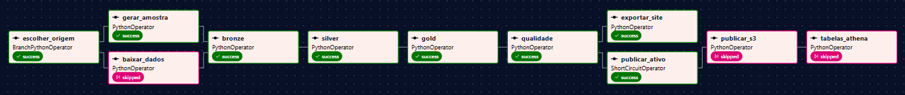

# Orquestração com Airflow

O fluxo completo do pipeline (dados brutos, bronze, silver, gold, qualidade, exportação para o site e publicação na AWS) roda como uma DAG do Apache Airflow, a `cnpj_monthly`. Cada tarefa executa o mesmo módulo que se roda na mão (`python -m cnpj_pipeline.bronze`, e assim por diante), em um processo separado, e a DAG só define a ordem e o que acontece quando algo falha.

```
escolher_origem ─┬─ baixar_dados ───┐
                 └─ gerar_amostra ──┴─ bronze ─ silver ─ gold ─ qualidade ─┬─ exportar_site
                                                                           └─ publicar_ativo ─ publicar_s3 ─ tabelas_athena
```



O grafo acima é de uma execução em modo amostra: a origem escolhida (`gerar_amostra`) e todas as etapas até a exportação em verde, e as tarefas de download e de publicação puladas, em rosa.

## Como subir

Com o Docker Desktop instalado, a partir desta pasta:

```bash
cd orchestration
docker compose up airflow-init     # cria o banco de metadados (uma vez)
docker compose up -d               # sobe API, agendador, processador de DAGs e Postgres
```

A tela fica em http://localhost:8080, sem login: a porta só aceita conexões da própria máquina. Para parar: `docker compose down` (os dados do mês ficam em `data/`, fora dos contêineres).

## Como rodar a DAG

Na tela, abra `cnpj_monthly` e use Trigger com a configuração desejada, ou pelo terminal:

```bash
# amostra sintética, em segundos
docker compose exec airflow-scheduler airflow dags trigger cnpj_monthly --conf '{"mode": "sample"}'

# mês real, em horas (usa o que já existe em data/ e só refaz o que falta)
docker compose exec airflow-scheduler airflow dags trigger cnpj_monthly --conf '{"mode": "full", "month": "2026-10"}'
```

| Parâmetro | Padrão | O que faz |
| --- | --- | --- |
| `mode` | `sample` | `sample`: dados sintéticos em `data/sample`, com as tolerâncias da demonstração; nunca toca em `data/raw` nem em `docs/`. `full`: o mês real. |
| `month` | `2026-10` | Mês de referência AAAA-MM, usado no modo `full` (a amostra usa um mês fictício). |
| `force` | `false` | Refaz bronze, silver e gold que já existem. A amostra sempre refaz. |
| `publish` | `false` | No modo `full`, publica a gold no S3 e cria as tabelas no Athena. Exige credenciais da AWS (abaixo). |

## Decisões

- **Qualidade como portão.** A tarefa `qualidade` roda as verificações completas sobre bronze, silver e gold. Se uma verificação bloqueante falhar, a tarefa falha e `exportar_site`, `publicar_s3` e `tabelas_athena` não executam: nada vai para o site nem para a nuvem com dado reprovado. A gold em si é construída antes, com as suas próprias verificações, e fica em `data/gold` para inspeção.
- **Tarefas finas, lógica testável.** A montagem de cada comando (caminhos por modo, tolerâncias, `--force`) fica em `src/cnpj_pipeline/orchestration.py`, em Python puro, e é testada sem o Airflow (`tests/test_orchestration.py`, inclusive o modo amostra executado etapa por etapa). A DAG em si é checada em `tests/test_orchestration_dag.py`: sem erro de importação, ordem das tarefas, portão de qualidade, parâmetros padrão seguros.
- **Cada etapa em um processo próprio.** Isola a memória do DuckDB de uma etapa para a outra e mantém o comando idêntico ao que se roda na mão. A saída do processo vai para o log da tarefa.
- **Idempotência.** Cada camada pula o que já existe, então reexecutar uma tarefa que falhou, ou a DAG inteira, não duplica nada; `force` refaz.
- **Sem repetição automática, exceto no download.** Uma falha de dado não melhora repetindo; o download tem 2 novas tentativas, além das 8 por arquivo que o próprio módulo já faz.
- **Disparo manual e uma execução por vez.** O mês real leva horas e as execuções compartilham as mesmas pastas de dados, então a DAG não tem agenda (`schedule=None`) e `max_active_runs=1`.
- **LocalExecutor com Postgres.** Todas as tarefas rodam na mesma máquina que os dados; fila e workers separados só acrescentariam peças.
- **Profiling fora da DAG.** O profiling (`cnpj_pipeline.profiling`) é análise exploratória que informou as regras da silver e roda sob demanda, não a cada mês.

## Publicar na AWS

As tarefas `publicar_s3` e `tabelas_athena` só executam com `mode=full` e `publish=true`. Elas precisam do perfil do AWS CLI e do nome do bucket:

```bash
cp .env.example .env               # preencha CNPJ_S3_BUCKET
docker compose -f docker-compose.yml -f docker-compose.aws.yml up -d
```

O arquivo `docker-compose.aws.yml` monta `~/.aws` somente leitura no agendador, que é quem executa as tarefas. As chaves não entram na imagem nem no repositório.

## Limites

- A execução é local: o Airflow roda no Docker da própria máquina. O nível 2 da AWS (ECS Fargate) continua no [Roadmap](../README.md#roadmap).
- Não há sensor que espere a Receita publicar o mês: o disparo é manual, depois de o mês estar disponível.
- A DAG não tem alertas (e-mail ou chat) para falhas; o estado de cada tarefa e o log ficam na tela do Airflow.

## Testes da DAG

```bash
# lógica das tarefas, sem Airflow (roda no CI e na máquina local)
pytest tests/test_orchestration.py

# integridade da DAG, com o Airflow (roda no CI e dentro do contêiner)
docker compose exec airflow-scheduler pytest /opt/cnpj/tests/test_orchestration_dag.py
```
